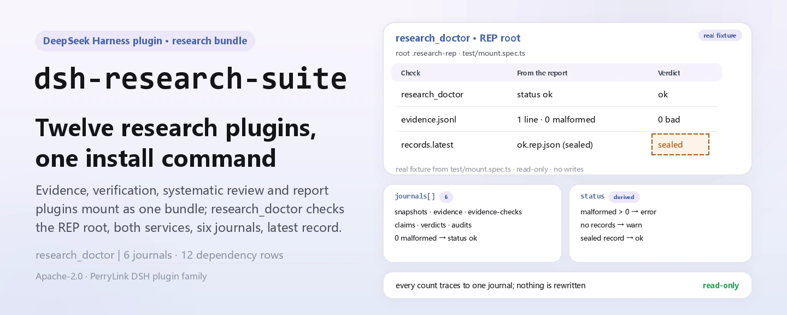
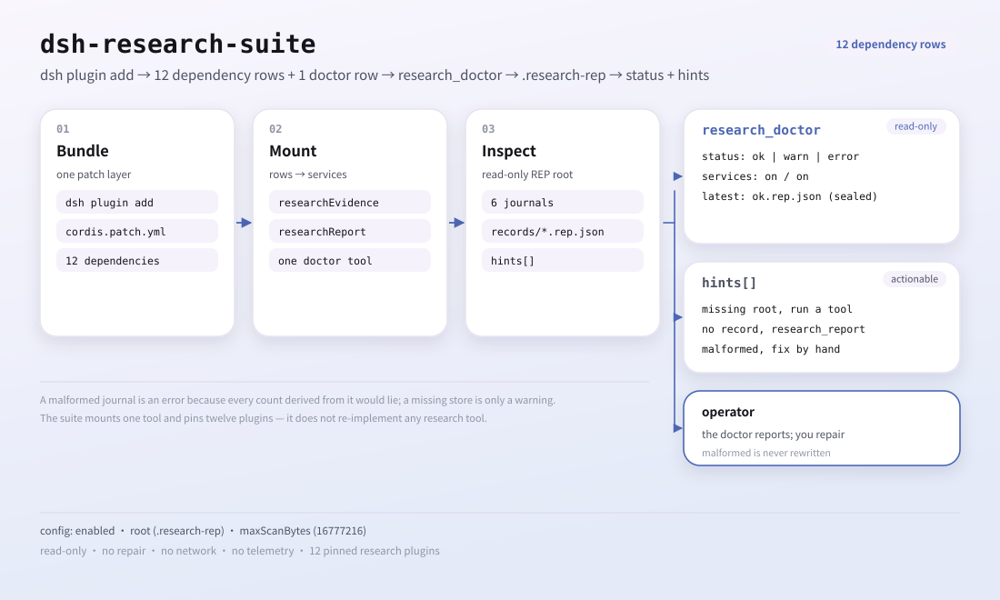
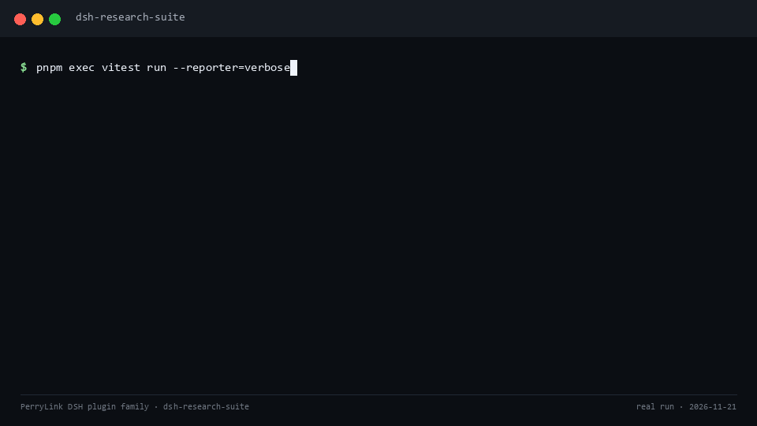

<div align="center">

<picture>
  <source media="(prefers-color-scheme: dark)" srcset="docs/assets/dsh-research-suite-hero-en-dark.webp">
  
</picture>

# dsh-research-suite

**Un solo comando para la familia de investigación — más un doctor que te dice si el almacén de evidencias está sano.**

*Instala los doce plugins de evidencias, verificación, revisión sistemática e informes como una única capa bundle — el paquete es `dsh-research-suite-plugin` — y monta `research_doctor`: una comprobación de solo lectura de la raíz REP, los servicios montados, cada journal y el último registro sellado.*

[English](README.md) · [简体中文](README-zh.md) · [Português](README-pt.md) · [हिन्दी](README-hi.md)

[](LICENSE)
[]()
[](https://github.com/topics/dsh-plugin)

</div>

---

## Por qué un bundle

La familia de investigación está deliberadamente separada en paquetes: `dsh-research-core`, `dsh-doc-anchor`, `dsh-cite-verify`, `dsh-claim-check`, `dsh-statcheck`, `dsh-retraction-watch`, `dsh-repro-audit`, `dsh-sr-ledger`, `dsh-meta-analysis`, `dsh-manuscript-check`, `dsh-research-report` y `dsh-library`. Eso es bueno para componer y malo para empezar: un perfil nuevo necesita doce instalaciones y una forma de saber si las filas se montaron de verdad.

Este paquete es el **bundle** de ese conjunto. Un solo árbol de dependencias, un solo `cordis.patch.yml`, una sola fila `research_doctor`. No reimplementa ninguna herramienta.


<picture>
  <source media="(prefers-color-scheme: dark)" srcset="docs/assets/dsh-research-suite-flow-v5-dark.svg">
  
</picture>

*Estructura: instalar → montar → inspeccionar; `research_doctor` es la única herramienta que añade este paquete y nunca repara. Las etiquetas del diagrama son los nombres reales de servicios, archivos de journal y claves de configuración, así que la misma imagen sirve para los cinco idiomas.*

## Instalación

```sh
dsh plugin --profile <name> add dsh-research-suite-plugin
dsh --profile <name> --dump-config | grep -E 'research|cite-verify|doc-anchor|statcheck|claim-check|sr-ledger|meta-analysis|manuscript|retraction|repro-audit|library'
```

Luego pídele al agente:

```text
Run research_doctor.
```

Un perfil sano informa `research_doctor: ok`, ambos servicios en `on` y el último registro como `(sealed)`.

## Qué comprueba `research_doctor`



*Animado: la salida real de `pnpm exec vitest run` el 2026-11-21 (3 archivos de prueba, 9 pruebas), y después `pnpm run verify:package`. El bundle no tiene CLI propia, así que el contrato del doctor y la puerta del paquete son la ejecución; los marcadores de aprobado y los tiempos se omiten.*


| Comprobación | Significado |
|---|---|
| `services.researchEvidence` | `ctx.researchEvidence` está montado (core activo) |
| `services.researchReport` | `ctx.researchReport` está montado (`dsh-research-report` activo) |
| `journals[]` | `snapshots/evidence/evidence-checks/claims/verdicts/audits.jsonl`: existe, bytes, líneas, malformadas |
| `records` | recuento de `records/*.rep.json` sellados, archivos malformados, y del último registro id/createdAt/evidence/claims/sealed |
| `hints[]` | qué arreglar a continuación (raíz ausente, sin registro, registro sin sellar, journal malformado, servicio ausente) |

Es de **solo lectura**. Nunca repara, borra, edita ni crea un registro. Un journal con líneas malformadas hace que el estado sea `error`, porque cada recuento derivado de él sería poco fiable; un almacén ausente es solo `warn` (un perfil nuevo todavía no tiene registros).

## Compatibilidad

| | |
|---|---|
| DeepSeek Harness | `dsh-v0.2.2-rc.4` (verificado en esta máquina) — peer line `>=0.2.1-0 <0.3.0 \|\| >=0.2.2-0 <0.3.0` |
| Node | `^22.19.0 \|\| >=24.9.0` (probado en `24.22.1`), solo ESM |
| Peers | `@deepseek-ai/cordis ^4.0.5-alpha.1`, `@deepseek-ai/dsh-tools`, `@deepseek-ai/schemastery ^3.18.5-alpha.1` |
| Dependencias de ejecución | los doce plugins de investigación (fijados) |
| Almacén | `.research-rep` (el mismo valor por defecto que `dsh-research-core`) |

## Configuración

| Clave | Valor por defecto | Significado |
|---|---|---|
| `enabled` | `true` | `false` no monta la herramienta doctor (las demás filas se mantienen) |
| `root` | `.research-rep` | raíz REP que lee el doctor, resuelta contra el directorio de trabajo del harness |
| `maxScanBytes` | `16777216` | tope de escaneo por journal/archivo; los archivos mayores se cuentan pero no se analizan |

El doctor también acepta un `root` por llamada.

## Qué no hace este paquete

- **Ninguna herramienta propia más allá del doctor.** Todas las herramientas de evidencias, verificación e informes pertenecen a sus plugins.
- **Ninguna reparación automática.** Un journal malformado se informa, nunca se reescribe.
- **Sin telemetría ni red.** El doctor lee archivos locales y `ctx.get`.
- **Sin instalación oculta.** El bundle es un árbol de dependencias normal; se desinstala como cualquier otro plugin.

## Desarrollo

```sh
pnpm install
pnpm run check:lockfile
pnpm typecheck
pnpm test
pnpm build
pnpm verify:package
```

El lockfile se confirma exactamente como lo escribe `pnpm install --lockfile-only` (dos documentos: el del gestor de paquetes de pnpm y luego el del proyecto), así que una instalación local no lo reescribe. `pnpm run check:lockfile` falla cuando el lockfile se desvía de `package.json` o pierde esa forma.

## Licencia

Apache-2.0. Consulta [LICENSE](LICENSE).
