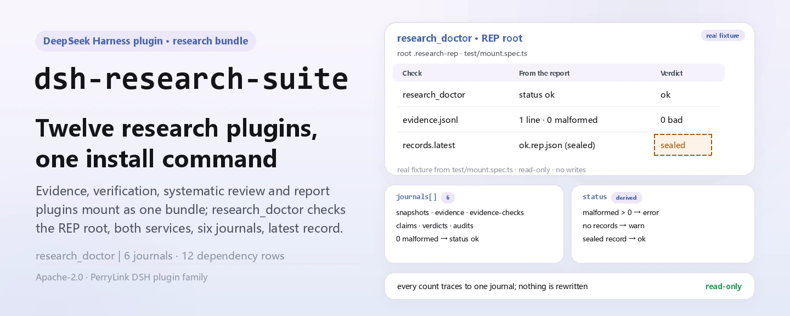
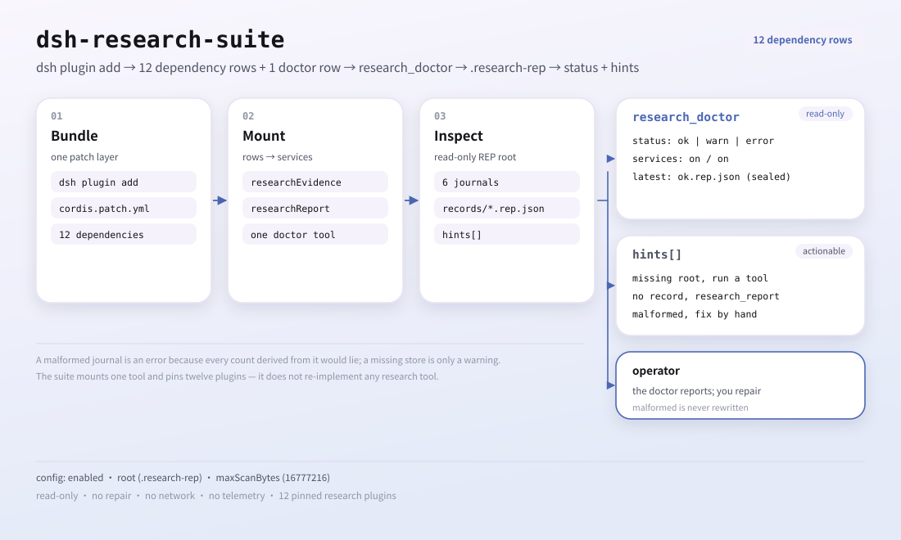
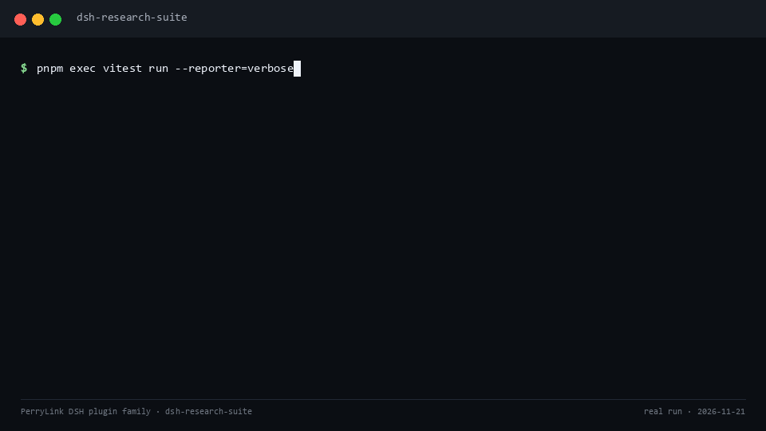

<div align="center">

<picture>
  <source media="(prefers-color-scheme: dark)" srcset="docs/assets/dsh-research-suite-hero-en-dark.webp">
  
</picture>

# dsh-research-suite

**अनुसंधान परिवार के लिए एक ही कमांड — साथ में एक doctor जो बताता है कि एविडेंस स्टोर स्वस्थ है या नहीं।**

*बारह एविडेंस, सत्यापन, व्यवस्थित समीक्षा और रिपोर्ट प्लगइन को एक ही bundle परत के रूप में इंस्टॉल करता है — पैकेज `dsh-research-suite-plugin` है — और `research_doctor` माउंट करता है: REP रूट, माउंट की गई सेवाओं, हर journal और नवीनतम सीलबद्ध रिकॉर्ड की केवल-पढ़ने वाली जाँच।*

[English](README.md) · [简体中文](README-zh.md) · [Español](README-es.md) · [Português](README-pt.md)

[](LICENSE)
[]()
[](https://github.com/topics/dsh-plugin)

</div>

---

## bundle क्यों

अनुसंधान परिवार जानबूझकर अलग-अलग पैकेजों में बँटा है: `dsh-research-core`, `dsh-doc-anchor`, `dsh-cite-verify`, `dsh-claim-check`, `dsh-statcheck`, `dsh-retraction-watch`, `dsh-repro-audit`, `dsh-sr-ledger`, `dsh-meta-analysis`, `dsh-manuscript-check`, `dsh-research-report` और `dsh-library`। यह जोड़ने के लिए अच्छा है और शुरुआत के लिए बुरा: नए profile को बारह इंस्टॉल चाहिए, और यह पता करने का कोई तरीका चाहिए कि पंक्तियाँ सचमुच माउंट हुईं या नहीं।

यह पैकेज उसी समूह का **bundle** है। एक ही dependency ट्री, एक ही `cordis.patch.yml`, एक ही `research_doctor` पंक्ति। यह किसी भी टूल को दोबारा लागू नहीं करता।

<picture>
  <source media="(prefers-color-scheme: dark)" srcset="docs/assets/dsh-research-suite-flow-v5-dark.svg">
  
</picture>

*संरचना: इंस्टॉल → माउंट → जाँच; `research_doctor` ही इस पैकेज का एकमात्र नया टूल है और वह कभी मरम्मत नहीं करता। डायग्राम के अंदर केवल असली सेवा नाम, journal फ़ाइलें और कॉन्फ़िग कुंजियाँ हैं, इसलिए एक ही चित्र पाँचों भाषाओं के लिए काम आता है।*

## इंस्टॉल

```sh
dsh plugin --profile <name> add dsh-research-suite-plugin
dsh --profile <name> --dump-config | grep -E 'research|cite-verify|doc-anchor|statcheck|claim-check|sr-ledger|meta-analysis|manuscript|retraction|repro-audit|library'
```

फिर agent से कहें:

```text
Run research_doctor.
```

स्वस्थ profile `research_doctor: ok`, दोनों सेवाएँ `on`, और नवीनतम रिकॉर्ड `(sealed)` बताता है।

## `research_doctor` क्या जाँचता है



*एनिमेटेड: 2026-11-21 को `pnpm exec vitest run` का असली आउटपुट (3 टेस्ट फ़ाइलें, 9 टेस्ट), फिर `pnpm run verify:package`। इस bundle का अपना कोई CLI नहीं है, इसलिए doctor कॉन्ट्रैक्ट और पैकेज गेट ही वह रन हैं; पास मार्कर और समय हटा दिए गए हैं।*

| जाँच | अर्थ |
|---|---|
| `services.researchEvidence` | `ctx.researchEvidence` माउंट है (core सक्रिय) |
| `services.researchReport` | `ctx.researchReport` माउंट है (`dsh-research-report` सक्रिय) |
| `journals[]` | `snapshots/evidence/evidence-checks/claims/verdicts/audits.jsonl`: मौजूदगी, bytes, पंक्तियाँ, खराब पंक्तियाँ |
| `records` | सीलबद्ध `records/*.rep.json` की गिनती, खराब फ़ाइलें, और नवीनतम रिकॉर्ड का id/createdAt/evidence/claims/sealed |
| `hints[]` | आगे क्या ठीक करना है (रूट नहीं है, रिकॉर्ड नहीं है, रिकॉर्ड सीलबद्ध नहीं है, journal खराब है, सेवा नहीं है) |

यह **केवल-पढ़ने** वाला है। यह कभी मरम्मत, मिटाव, संपादन या रिकॉर्ड निर्माण नहीं करता। खराब journal होने पर status `error` होता है, क्योंकि उससे निकला हर आँकड़ा अविश्वसनीय होगा; स्टोर का न होना केवल `warn` है (नए profile में अभी कोई रिकॉर्ड नहीं होता)।

## अनुकूलता

| | |
|---|---|
| DeepSeek Harness | `dsh-v0.2.3-alpha.1` (इस मशीन पर सत्यापित) — peer line `>=0.2.1-0 <0.3.0 \|\| >=0.2.2-0 <0.3.0` |
| Node | `^22.19.0 \|\| >=24.9.0` (`24.22.1` पर परीक्षित), केवल ESM |
| Peers | `@deepseek-ai/cordis ^4.0.5-alpha.1`, `@deepseek-ai/dsh-tools`, `@deepseek-ai/schemastery ^3.18.5-alpha.1` |
| रनटाइम निर्भरताएँ | बारह अनुसंधान प्लगइन (पिन किए गए) |
| स्टोर | `.research-rep` (`dsh-research-core` के समान डिफ़ॉल्ट) |

## कॉन्फ़िगरेशन

| कुंजी | डिफ़ॉल्ट | अर्थ |
|---|---|---|
| `enabled` | `true` | `false` होने पर doctor टूल माउंट नहीं होता (बाकी पंक्तियाँ बनी रहती हैं) |
| `root` | `.research-rep` | doctor जिस REP रूट को पढ़ता है, harness के कार्य-निर्देशिका के सापेक्ष हल किया जाता है |
| `maxScanBytes` | `16777216` | प्रति journal/फ़ाइल स्कैन सीमा; बड़ी फ़ाइलें गिनी जाती हैं पर पढ़ी नहीं जातीं |

doctor प्रति-कॉल `root` ओवरराइड भी स्वीकार करता है।

## यह पैकेज क्या नहीं करता

- **doctor के अलावा अपना कोई टूल नहीं।** एविडेंस, सत्यापन और रिपोर्ट के सारे टूल अपने-अपने प्लगइन के हैं।
- **कोई स्वचालित मरम्मत नहीं।** खराब journal की सूचना मिलती है, उसे कभी दोबारा नहीं लिखा जाता।
- **कोई टेलीमेट्री नहीं, कोई नेटवर्क नहीं।** doctor स्थानीय फ़ाइलें और `ctx.get` पढ़ता है।
- **कोई छिपा इंस्टॉल नहीं।** bundle एक सामान्य dependency ट्री है; किसी भी अन्य प्लगइन की तरह अनइंस्टॉल करें।

## विकास

```sh
pnpm install
pnpm run check:lockfile
pnpm typecheck
pnpm test
pnpm build
pnpm verify:package
```

lockfile ठीक वैसा ही commit होता है जैसा `pnpm install --lockfile-only` लिखता है (दो दस्तावेज़: pnpm का अपना पैकेज-मैनेजर दस्तावेज़, फिर प्रोजेक्ट का दस्तावेज़), इसलिए स्थानीय इंस्टॉल उसे नहीं बदलता। `pnpm run check:lockfile` तब विफल होता है जब lockfile `package.json` से हट जाए या वह रूप खो दे।

## लाइसेंस

Apache-2.0। देखें [LICENSE](LICENSE)।
