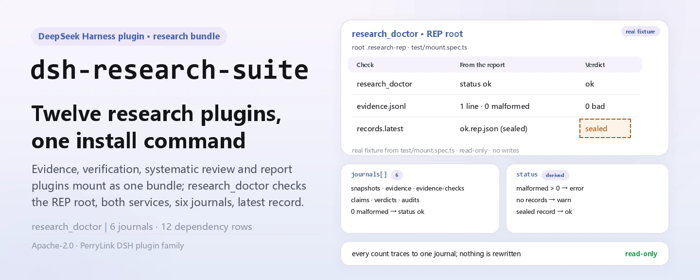
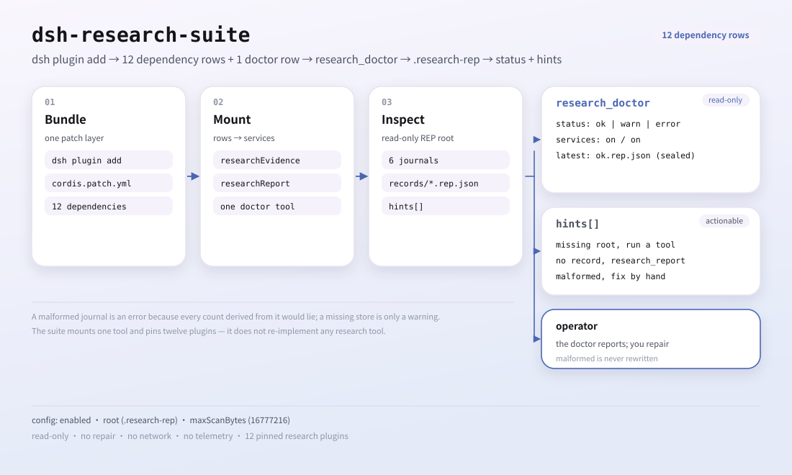
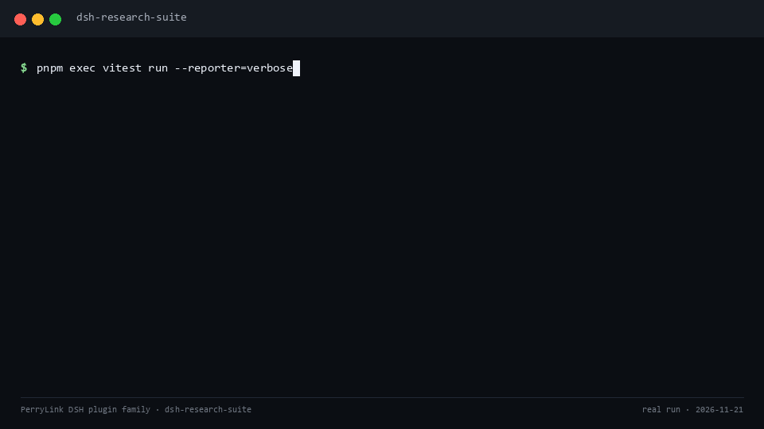

<div align="center">

<picture>
  <source media="(prefers-color-scheme: dark)" srcset="docs/assets/dsh-research-suite-hero-en-dark.webp">
  
</picture>

# dsh-research-suite

**Um único comando para a família de pesquisa — mais um doctor que diz se o armazenamento de evidências está saudável.**

*Instala os doze plugins de evidências, verificação, revisão sistemática e relatórios como uma única camada bundle — o pacote é `dsh-research-suite-plugin` — e monta o `research_doctor`: uma verificação somente leitura da raiz REP, dos serviços montados, de cada journal e do último registro selado.*

[English](README.md) · [简体中文](README-zh.md) · [Español](README-es.md) · [हिन्दी](README-hi.md)

[](LICENSE)
[]()
[](https://github.com/topics/dsh-plugin)

</div>

---

## Por que um bundle

A família de pesquisa é deliberadamente dividida em pacotes separados: `dsh-research-core`, `dsh-doc-anchor`, `dsh-cite-verify`, `dsh-claim-check`, `dsh-statcheck`, `dsh-retraction-watch`, `dsh-repro-audit`, `dsh-sr-ledger`, `dsh-meta-analysis`, `dsh-manuscript-check`, `dsh-research-report` e `dsh-library`. Isso é bom para compor e ruim para começar: um perfil novo precisa de doze instalações e de uma forma de saber se as linhas realmente montaram.

Este pacote é o **bundle** desse conjunto. Uma única árvore de dependências, um único `cordis.patch.yml`, uma única linha `research_doctor`. Ele não reimplementa nenhuma ferramenta.


<picture>
  <source media="(prefers-color-scheme: dark)" srcset="docs/assets/dsh-research-suite-flow-v5-dark.svg">
  
</picture>

*Estrutura: instalar → montar → inspecionar; o `research_doctor` é a única ferramenta que este pacote adiciona e ele nunca repara. Os rótulos do diagrama são os nomes reais de serviços, arquivos de journal e chaves de configuração, então a mesma imagem serve aos cinco idiomas.*

## Instalação

```sh
dsh plugin --profile <name> add dsh-research-suite-plugin
dsh --profile <name> --dump-config | grep -E 'research|cite-verify|doc-anchor|statcheck|claim-check|sr-ledger|meta-analysis|manuscript|retraction|repro-audit|library'
```

Depois peça ao agente:

```text
Run research_doctor.
```

Um perfil saudável relata `research_doctor: ok`, ambos os serviços em `on` e o último registro como `(sealed)`.

## O que o `research_doctor` verifica



*Animado: a saída real de `pnpm exec vitest run` em 2026-11-21 (3 arquivos de teste, 9 testes) e depois `pnpm run verify:package`. O bundle não tem CLI própria, então o contrato do doctor e o portão do pacote são a execução; marcadores de aprovação e tempos foram omitidos.*


| Verificação | Significado |
|---|---|
| `services.researchEvidence` | `ctx.researchEvidence` está montado (core ativo) |
| `services.researchReport` | `ctx.researchReport` está montado (`dsh-research-report` ativo) |
| `journals[]` | `snapshots/evidence/evidence-checks/claims/verdicts/audits.jsonl`: existe, bytes, linhas, malformadas |
| `records` | contagem de `records/*.rep.json` selados, arquivos malformados e do último registro id/createdAt/evidence/claims/sealed |
| `hints[]` | o que corrigir em seguida (raiz ausente, sem registro, registro não selado, journal malformado, serviço ausente) |

É **somente leitura**. Nunca repara, apaga, edita ou cria um registro. Um journal com linhas malformadas torna o status `error`, porque toda contagem derivada dele seria não confiável; um armazenamento ausente é apenas `warn` (um perfil novo ainda não tem registros).

## Compatibilidade

| | |
|---|---|
| DeepSeek Harness | `dsh-v0.2.2-rc.4` (verificado nesta máquina) — peer line `>=0.2.1-0 <0.3.0 \|\| >=0.2.2-0 <0.3.0` |
| Node | `^22.19.0 \|\| >=24.9.0` (testado em `24.22.1`), somente ESM |
| Peers | `@deepseek-ai/cordis ^4.0.5-alpha.1`, `@deepseek-ai/dsh-tools`, `@deepseek-ai/schemastery ^3.18.5-alpha.1` |
| Dependências de execução | os doze plugins de pesquisa (fixados) |
| Armazenamento | `.research-rep` (o mesmo padrão do `dsh-research-core`) |

## Configuração

| Chave | Padrão | Significado |
|---|---|---|
| `enabled` | `true` | `false` não monta a ferramenta doctor (as demais linhas continuam) |
| `root` | `.research-rep` | raiz REP que o doctor lê, resolvida contra o diretório de trabalho do harness |
| `maxScanBytes` | `16777216` | limite de varredura por journal/arquivo; arquivos maiores são contados, não analisados |

O doctor também aceita um `root` por chamada.

## O que este pacote não faz

- **Nenhuma ferramenta própria além do doctor.** Todas as ferramentas de evidências, verificação e relatórios pertencem aos seus plugins.
- **Nenhum reparo automático.** Um journal malformado é relatado, nunca reescrito.
- **Sem telemetria e sem rede.** O doctor lê arquivos locais e `ctx.get`.
- **Sem instalação oculta.** O bundle é uma árvore de dependências normal; desinstale como qualquer outro plugin.

## Desenvolvimento

```sh
pnpm install
pnpm run check:lockfile
pnpm typecheck
pnpm test
pnpm build
pnpm verify:package
```

O lockfile é commitado exatamente como `pnpm install --lockfile-only` o escreve (dois documentos: o do gerenciador de pacotes do pnpm e depois o do projeto), então uma instalação local não o reescreve. `pnpm run check:lockfile` falha quando o lockfile se desvia do `package.json` ou perde essa forma.

## Licença

Apache-2.0. Veja [LICENSE](LICENSE).
